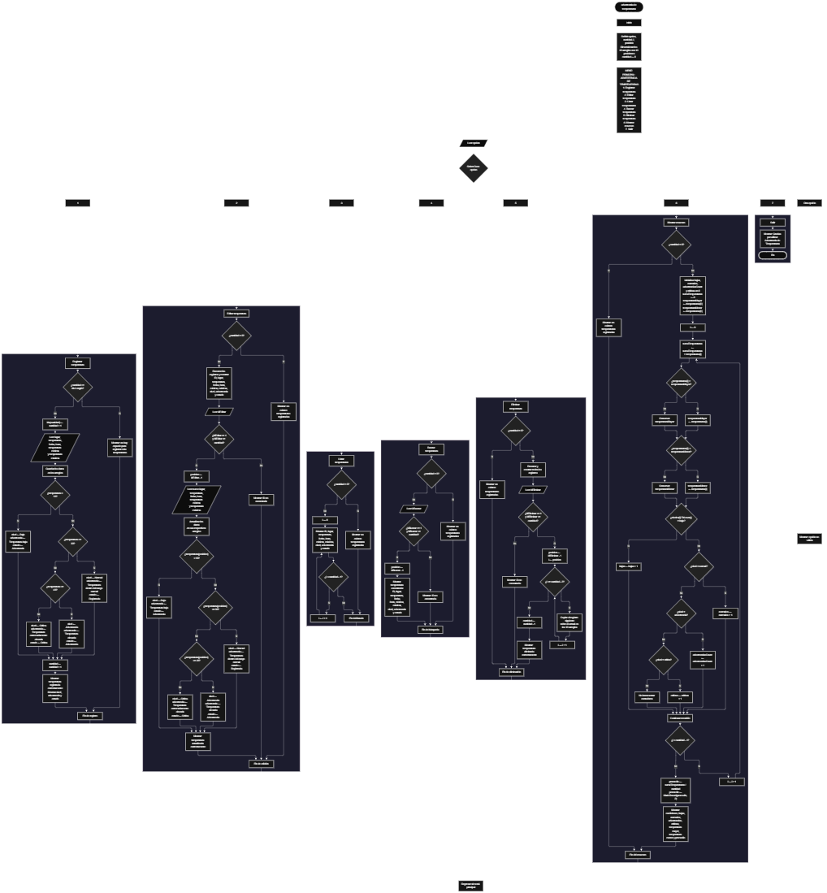

Este proyecto, llamado <b>advertencia de temperaturas</b>, fue desarrollado en <b>visual basic .net</b> como un ejercicio práctico para fortalecer la lógica de programación mediante la creación de un sistema de registro y control de temperaturas desde la consola. El programa cuenta con un menú principal de siete opciones que permite <b>registrar, editar, eliminar, buscar, listar y consultar un resumen</b> de las mediciones almacenadas. Cada registro contiene información como el lugar, la temperatura, la fecha, la hora, los valores mínimos y máximos, el nivel de temperatura, las advertencias y el estado correspondiente, utilizando arreglos con una capacidad máxima de <b>10 mediciones durante la ejecución</b>. Además, incorpora una clasificación automática que identifica las temperaturas bajas, normales, elevadas y críticas, generando mensajes de advertencia según los valores registrados. Durante su desarrollo se aplicaron conceptos fundamentales de programación, como variables, arreglos, estructuras condicionales, ciclos repetitivos y estructuras de selección, además de procesos para buscar, modificar, eliminar y organizar registros.

<h2 align="center">⚙️ Funcionamiento del menú principal</h2>

### ➕ Registrar temperatura

La opción <b>1) registrar temperatura</b> permite almacenar una nueva medición en el sistema. Antes de realizar el registro, el programa comprueba que la cantidad de mediciones almacenadas sea menor que la capacidad máxima de los arreglos mediante la condición <b>cantidad &gt;= ids.Length</b>. Si existe espacio disponible, asigna un identificador utilizando la expresión <b>cantidad + 1</b> y solicita el <b>lugar, temperatura en °C, fecha, hora, temperatura mínima y temperatura máxima</b>. Después, utiliza estructuras condicionales <b>if, elseif y else</b> para clasificar automáticamente la temperatura. Si el valor es menor que <b>10 °C</b>, establece el nivel <b>"Baja"</b>, genera la advertencia <b>"Temperatura baja"</b> y asigna el estado <b>"Advertencia"</b>. Si está entre <b>10 °C y 30 °C</b>, establece el nivel <b>"Normal"</b>, genera el mensaje <b>"Temperatura dentro del rango normal"</b> y asigna el estado <b>"Registrada"</b>. Si supera los <b>30 °C</b> y no supera los <b>40 °C</b>, establece el nivel <b>"Advertencia"</b>, genera el mensaje <b>"Temperatura elevada"</b> y asigna el estado <b>"Advertencia"</b>. Finalmente, si supera los <b>40 °C</b>, establece el nivel <b>"Critica"</b>, genera la advertencia <b>"Temperatura extremadamente elevada"</b> y asigna el estado <b>"Critica"</b>. Después de almacenar la información, aumenta la variable <b>cantidad</b> en uno y muestra un mensaje de confirmación junto con el nivel, la advertencia y el estado calculados. Si se alcanza la capacidad máxima, informa que no hay espacio para registrar más temperaturas.

### ✏️ Editar temperatura

La opción <b>2) editar temperatura</b> permite modificar la información de una medición registrada. Primero, el programa comprueba si existen temperaturas almacenadas mediante la variable <b>cantidad</b>. Si no hay registros, muestra el mensaje <b>"No existen temperaturas registradas."</b>. En caso contrario, utiliza un ciclo <b>for...next</b> para mostrar todas las mediciones con sus respectivos datos. Después, solicita el ID de la temperatura que se desea editar y comprueba que se encuentre dentro del rango permitido mediante la condición <b>idEditar &gt;= 1 And idEditar &lt;= cantidad</b>. Si el identificador es válido, calcula la posición mediante la expresión <b>idEditar - 1</b> y solicita el nuevo lugar, temperatura, fecha, hora, temperatura mínima y temperatura máxima. Los datos se actualizan directamente en sus respectivos arreglos. Posteriormente, vuelve a evaluar la temperatura utilizando las mismas condiciones de clasificación del registro para actualizar automáticamente el nivel, la advertencia y el estado. Finalmente, muestra el mensaje <b>"Temperatura actualizada correctamente."</b>. Si el ID introducido no se encuentra dentro del rango permitido, presenta el mensaje <b>"ID no encontrada."</b>.

### 🗑️ Eliminar temperatura

La opción <b>5) eliminar temperatura</b> permite eliminar una medición registrada mediante su identificador. Antes de comenzar, el programa comprueba que existan temperaturas almacenadas. Si no hay registros, muestra el mensaje <b>"No existen temperaturas registradas."</b>. Si existen mediciones, utiliza un ciclo <b>for...next</b> para mostrar todos los registros con su información completa. Después, solicita el ID de la temperatura que se desea eliminar y comprueba que esté dentro del rango válido. Si el identificador es correcto, calcula la posición mediante <b>idEliminar - 1</b> e inicia el proceso de reorganización. Para mantener los registros organizados, utiliza otro ciclo <b>for...next</b>, controlado por la variable <b>i</b>, que desplaza una posición hacia la izquierda los datos posteriores en los diez arreglos: <b>ids, lugares, temperaturas, fechas, horas, temperaturasMinimas, temperaturasMaximas, niveles, advertencias y estados</b>. Posteriormente, disminuye la variable <b>cantidad</b> en uno y muestra el mensaje <b>"Temperatura eliminada correctamente."</b>. Si el ID seleccionado no se encuentra dentro del rango permitido, informa que no se encontró la temperatura.

### 🔎 Buscar temperatura

La opción <b>4) buscar temperatura</b> permite localizar una medición mediante su identificador. Primero, el programa comprueba si existen temperaturas registradas. Si no hay información almacenada, muestra el mensaje <b>"No existen temperaturas registradas."</b>. En caso contrario, solicita el ID de la temperatura que se desea buscar y comprueba que esté dentro del rango permitido mediante la condición <b>idBuscar &gt;= 1 And idBuscar &lt;= cantidad</b>. Si la selección es válida, calcula la posición mediante <b>idBuscar - 1</b> y muestra la información completa de la medición: <b>ID, lugar, temperatura, fecha, hora, temperatura mínima, temperatura máxima, nivel, advertencia y estado</b>. Si el identificador introducido no corresponde a una posición dentro del rango establecido, presenta el mensaje <b>"ID no encontrada."</b>. La búsqueda utiliza directamente la posición calculada a partir del identificador, sin recorrer los arreglos para comparar cada ID.

### 📋 Listar temperaturas

La opción <b>3) listar temperaturas</b> permite visualizar todas las mediciones registradas actualmente en el sistema. Antes de mostrar la información, el programa comprueba si la variable <b>cantidad</b> es igual a cero. Si no existen registros, presenta el mensaje <b>"No existen temperaturas registradas."</b>. Si hay mediciones disponibles, muestra el título <b>"lista de temperaturas"</b> y utiliza un ciclo <b>for...next</b> para recorrer los arreglos desde la primera posición hasta la última medición registrada. Durante el recorrido, presenta el ID, lugar, temperatura, fecha, hora, valores mínimos y máximos, nivel, advertencia y estado de cada registro. Esta función facilita consultar todas las mediciones almacenadas sin necesidad de buscar cada una individualmente.

### 📊 Mostrar resumen

La opción <b>6) mostrar resumen</b> permite consultar estadísticas generales de las temperaturas registradas. Primero, el programa comprueba si existen mediciones almacenadas. Si no hay registros, muestra el mensaje <b>"No existen temperaturas registradas."</b>. En caso contrario, inicializa los contadores <b>bajas, normales, advertenciasCount y criticas</b>, además del acumulador <b>sumaTemperaturas</b>. También establece las variables <b>temperaturaMayor</b> y <b>temperaturaMenor</b> utilizando inicialmente el primer valor del arreglo <b>temperaturas</b>. Después, utiliza un ciclo <b>for...next</b> para recorrer las mediciones, acumular sus temperaturas, identificar el valor mayor y menor y contar los niveles correspondientes mediante estructuras condicionales. Para comparar los niveles, utiliza el método <b>.ToLower()</b>, que convierte el texto a minúsculas antes de realizar la comparación. Al finalizar el recorrido, calcula el promedio general mediante la expresión <b>sumaTemperaturas / cantidad</b> y utiliza <b>Math.Round(promedio, 2)</b> para redondear el resultado a dos decimales. Finalmente, muestra la cantidad de mediciones, las temperaturas bajas, normales, con advertencia y críticas, la temperatura mayor, la menor y el promedio general.

### 🚪 Salir del menú principal

La opción <b>7) salir</b> está destinada a finalizar la ejecución del programa y muestra el mensaje <b>"Gracias por utilizar Advertencia de Temperaturas."</b>. El menú principal se encuentra dentro de una estructura repetitiva <b>do...loop while</b>, que mantiene el programa en funcionamiento mientras la condición <b>opcion &lt;&gt; 7</b> sea verdadera. Cuando el usuario selecciona la opción 7, se muestra el mensaje de despedida y la condición del ciclo se cumple para finalizar la ejecución del programa.

<h2 align="center">🧠 Temas aplicados en el proyecto</h2>

### 📦 Variables

En este proyecto se utilizan variables para controlar la cantidad de temperaturas registradas, almacenar la opción seleccionada en el menú, identificar las posiciones de los arreglos y realizar los cálculos estadísticos del resumen. También se utilizan variables auxiliares para contar las diferentes clasificaciones, acumular las temperaturas y determinar los valores mayor y menor. Cada variable cumple una función específica dentro de las operaciones del sistema.

🔢 **Opcion:** Almacena la opción seleccionada por el usuario en el menú principal.

📊 **Cantidad:** Controla el número actual de temperaturas registradas.

🔄 **I:** Funciona como contador en los ciclos y permite recorrer los arreglos, además de controlar el desplazamiento de registros durante la eliminación.

🔎 **IdEditar:** Almacena el identificador de la temperatura que se desea modificar.

🔍 **IdBuscar:** Almacena el identificador de la temperatura que se desea consultar.

🗑️ **IdEliminar:** Almacena el identificador de la temperatura que se desea eliminar.

📍 **Posicion:** Determina la ubicación del registro dentro de los arreglos mediante la resta del identificador menos uno.

📉 **Bajas:** Cuenta las temperaturas clasificadas en el nivel bajo.

📊 **Normales:** Cuenta las temperaturas clasificadas en el nivel normal.

⚠️ **AdvertenciasCount:** Cuenta las temperaturas clasificadas en el nivel de advertencia.

🚨 **Criticas:** Cuenta las temperaturas clasificadas en el nivel crítico.

➕ **SumaTemperaturas:** Acumula los valores de las temperaturas registradas para calcular el promedio general.

🌡️ **TemperaturaMayor:** Almacena la temperatura más alta encontrada durante el recorrido.

🌡️ **TemperaturaMenor:** Almacena la temperatura más baja encontrada durante el recorrido.

📈 **Promedio:** Almacena el promedio general de las temperaturas registradas.

### 🗃️ Arreglos

En este proyecto se utilizan diez arreglos relacionados con la información de cada medición de temperatura. Cada arreglo tiene una capacidad de <b>10 posiciones</b> y utiliza el mismo índice para representar los datos correspondientes a un mismo registro. Por ejemplo, la información de una medición almacenada en la posición <b>0</b> se encuentra distribuida entre <b>ids(0), lugares(0), temperaturas(0), fechas(0), horas(0), temperaturasMinimas(0), temperaturasMaximas(0), niveles(0), advertencias(0) y estados(0)</b>. Esta organización permite registrar, consultar, modificar, mostrar y eliminar las mediciones de manera ordenada.

🆔 **Ids(10):** Almacena los identificadores de las mediciones registradas.

📍 **Lugares(10):** Almacena los lugares donde se realizan las mediciones.

🌡️ **Temperaturas(10):** Almacena los valores de temperatura registrados en grados Celsius.

📅 **Fechas(10):** Almacena las fechas de las mediciones.

🕒 **Horas(10):** Almacena las horas en que se realizan las mediciones.

📉 **TemperaturasMinimas(10):** Almacena los valores mínimos de temperatura proporcionados.

📈 **TemperaturasMaximas(10):** Almacena los valores máximos de temperatura proporcionados.

📊 **Niveles(10):** Almacena la clasificación asignada a cada temperatura: baja, normal, advertencia o crítica.

⚠️ **Advertencias(10):** Almacena los mensajes generados según la clasificación de cada temperatura.

📋 **Estados(10):** Almacena el estado correspondiente a cada medición: registrada, advertencia o crítica.

### 🔀 Estructuras condicionales

En este proyecto se utilizan las estructuras <b>if, elseif y else</b> para controlar las diferentes operaciones del menú y determinar la clasificación de las temperaturas. Estas condiciones permiten comprobar si existen registros antes de ejecutar una operación, verificar que la capacidad de los arreglos no haya sido alcanzada, validar los identificadores utilizados para editar, buscar o eliminar mediciones y clasificar automáticamente los valores registrados según los límites establecidos. También se utilizan condiciones para identificar las temperaturas mayores y menores y contar las diferentes categorías durante la generación del resumen.

### 🔄 Estructuras repetitivas

En este proyecto se utilizan los ciclos <b>for...next</b> y <b>do...loop while</b>. Los ciclos <b>for...next</b> permiten recorrer los arreglos para mostrar las mediciones registradas, consultar sus datos, calcular las estadísticas del resumen y desplazar los registros posteriores durante el proceso de eliminación. Por otro lado, el ciclo <b>do...loop while</b> mantiene activo el menú principal y permite que el usuario realice diferentes operaciones mientras no seleccione la opción de salida.

### 🎯 Estructura de selección

El programa utiliza la estructura <b>select case</b> para evaluar el valor almacenado en la variable <b>opcion</b> y ejecutar las instrucciones correspondientes. Cada caso representa una operación específica del sistema: <b>registrar, editar, listar, buscar, eliminar, mostrar resumen o salir</b>. También se utiliza el bloque <b>case else</b> para mostrar el mensaje <b>"Opcion no valida."</b> cuando el usuario introduce un número que no coincide con ninguna de las opciones definidas en el menú.

### 🔢 Dimensionamiento de arreglos

El programa utiliza la declaración de arreglos mediante la instrucción <b>Dim</b> para establecer la capacidad de los espacios destinados a almacenar las mediciones. Se definieron diez arreglos con un límite superior de <b>9</b>, lo que proporciona diez posiciones disponibles, desde el índice <b>0 hasta el 9</b>. La cantidad de posiciones ocupadas se controla mediante la variable <b>cantidad</b>, por lo que las operaciones recorren únicamente los registros comprendidos entre la primera posición y el total actual de mediciones.

### 🔄 Reorganización de registros

Cuando se selecciona una temperatura para eliminarla, el programa utiliza un ciclo <b>for...next</b> que comienza en la posición seleccionada y llega hasta <b>cantidad - 2</b>. En cada repetición, los datos de la posición siguiente se copian sobre la posición actual en los diez arreglos: <b>ids, lugares, temperaturas, fechas, horas, temperaturasMinimas, temperaturasMaximas, niveles, advertencias y estados</b>. Después, la variable <b>cantidad</b> disminuye en uno para indicar que existe un registro menos. De esta manera, las mediciones posteriores ocupan las posiciones disponibles sin dejar espacios vacíos entre los registros activos.

<h2 align="center">¿Cómo se implementaron las operaciones crud en el proyecto?</h2>

Las operaciones <b>crud</b> se implementaron mediante las opciones del menú principal, permitiendo administrar las mediciones de temperatura registradas. La operación <b>crear</b> corresponde a <b>registrar temperatura</b>, donde se introducen los datos de una nueva medición y se genera su clasificación automática; <b>leer</b> se realiza mediante las opciones <b>buscar temperatura, listar temperaturas y mostrar resumen</b>, que permiten consultar los registros y sus estadísticas; <b>actualizar</b> corresponde a <b>editar temperatura</b>, donde se modifican los datos de una medición y se recalculan su nivel, advertencia y estado; y <b>eliminar</b> se realiza mediante la opción <b>eliminar temperatura</b>, que retira un registro y reorganiza los arreglos. Estas operaciones utilizan variables, arreglos, condicionales y ciclos para gestionar la información almacenada temporalmente durante la ejecución del programa.

<h2 align="center">Diagrama de flujo del proyecto</h2>

<h2 align="center">🛡️ Validaciones del programa</h2>

### 📭 No existen temperaturas registradas

Esta validación se utiliza en las opciones de <b>editar, eliminar, buscar, listar y mostrar resumen</b>. El programa comprueba si la variable <b>cantidad</b> es igual a <b>0</b> y, si no existen temperaturas registradas, muestra el mensaje <b>"No existen temperaturas registradas."</b>. Esta comprobación evita continuar con las operaciones que necesitan información almacenada cuando no hay mediciones disponibles.

### ⚠️ Capacidad máxima alcanzada

Esta validación se utiliza durante el registro de nuevas temperaturas para controlar la capacidad máxima de los arreglos. El programa comprueba si <b>cantidad &gt;= ids.Length</b> antes de permitir agregar una nueva medición. Si existe espacio disponible, asigna el identificador y solicita los datos correspondientes. En caso contrario, muestra el mensaje <b>"No hay espacio para registrar mas temperaturas."</b>, impidiendo almacenar más registros cuando se alcanza la capacidad máxima de diez mediciones.

### 🔢 Identificador no encontrado

Esta validación se utiliza durante las operaciones de <b>editar, buscar y eliminar</b>. El programa comprueba que el identificador introducido sea mayor o igual a <b>1</b> y menor o igual al valor de <b>cantidad</b>. Si el valor se encuentra dentro del rango permitido, calcula la posición correspondiente mediante la expresión <b>ID - 1</b> y continúa con la operación seleccionada. Si el identificador está fuera del rango, muestra el mensaje <b>"ID no encontrada."</b>. Esta comprobación controla el acceso a las posiciones de los arreglos utilizadas por estas operaciones.

### 🌡️ Clasificación automática de temperaturas

El programa utiliza estructuras condicionales para clasificar las mediciones según su valor en grados Celsius. Los valores inferiores a <b>10 °C</b> se clasifican como bajos; los valores desde <b>10 °C hasta 30 °C</b> se consideran normales; los valores superiores a <b>30 °C y hasta 40 °C</b> generan una advertencia por temperatura elevada; y los valores superiores a <b>40 °C</b> se clasifican como críticos. Esta clasificación se realiza al registrar y editar una medición, actualizando el nivel, el mensaje de advertencia y el estado correspondiente.

### 📊 Cálculo del resumen estadístico

El programa utiliza un ciclo <b>for...next</b> para recorrer las temperaturas registradas y calcular sus estadísticas. Durante el recorrido, cuenta las mediciones según sus niveles, acumula los valores para calcular el promedio e identifica la temperatura mayor y menor. Para obtener el promedio general, divide la suma de las temperaturas entre la cantidad de registros. Finalmente, utiliza <b>Math.Round(promedio, 2)</b> para presentar el resultado con dos decimales. Esta operación solamente se ejecuta cuando existen mediciones registradas.

### ⚠️ Conversión de datos numéricos

El programa utiliza los métodos <b>Convert.ToInt32()</b> y <b>Convert.ToDouble()</b> para convertir los valores introducidos por el usuario en datos numéricos. Estas conversiones permiten almacenar las opciones del menú, los identificadores, las temperaturas y los valores mínimos y máximos en sus respectivos tipos de datos. Sin embargo, el código no utiliza <b>TryParse</b> ni mecanismos de control de excepciones, por lo que una entrada que no pueda convertirse correctamente puede provocar un error durante la ejecución.

### ⚠️ Reorganización de identificadores

Durante la eliminación de una temperatura, el programa desplaza los datos de los arreglos hacia la izquierda y disminuye la variable <b>cantidad</b>. Sin embargo, los identificadores almacenados en el arreglo <b>ids</b> no se vuelven a numerar después del desplazamiento. Como las operaciones de edición, búsqueda y eliminación calculan la posición mediante <b>ID - 1</b>, esta situación puede provocar que, después de eliminar una medición intermedia, se acceda a un registro diferente del esperado. Es una observación importante del funcionamiento actual del programa.

### ⚠️ Opción inválida

La estructura <b>select case</b> incluye el bloque <b>case else</b>, que muestra el mensaje <b>"Opcion no valida."</b> cuando el usuario introduce un número que no corresponde a ninguna de las opciones definidas en el menú. Esta comprobación permite informar al usuario cuando selecciona una opción que no está disponible.

<h2 align="center">🎯 Objetivo del proyecto</h2>

El objetivo principal de este proyecto es fortalecer la <b>lógica de programación</b> mediante el desarrollo de un sistema de registro y advertencia de temperaturas en <b>visual basic .net</b>. A través de su construcción se busca aplicar los conocimientos adquiridos sobre variables, arreglos, estructuras condicionales, ciclos repetitivos y estructuras de selección, integrándolos para resolver un problema de manera organizada. Además, permite comprender cómo registrar, consultar, modificar y eliminar mediciones, clasificar temperaturas automáticamente, generar advertencias y calcular estadísticas como el promedio, el valor máximo y el mínimo. Este proyecto sirve como base para desarrollar sistemas de monitoreo y gestión de información más completos utilizando otros lenguajes y tecnologías.

